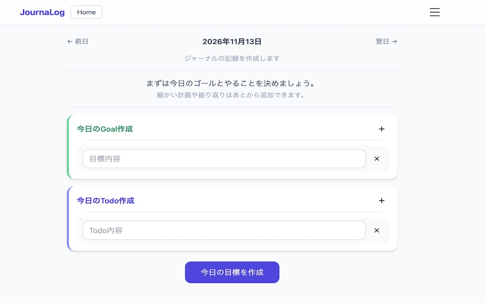
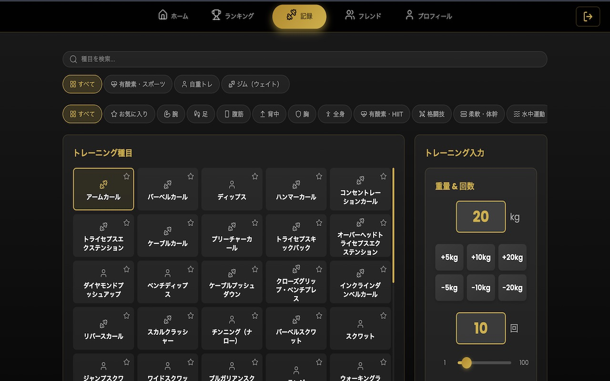
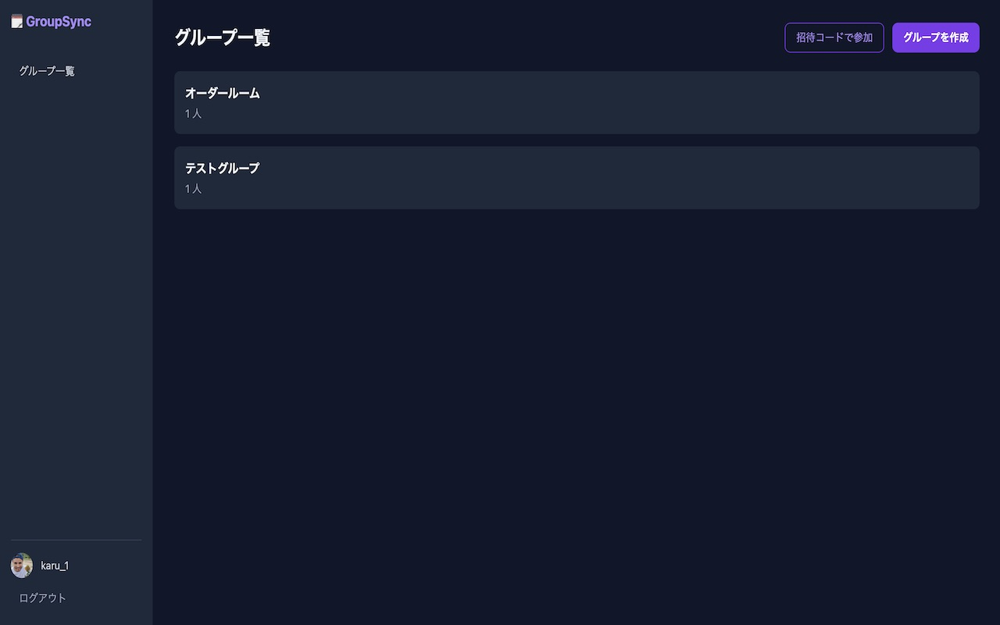
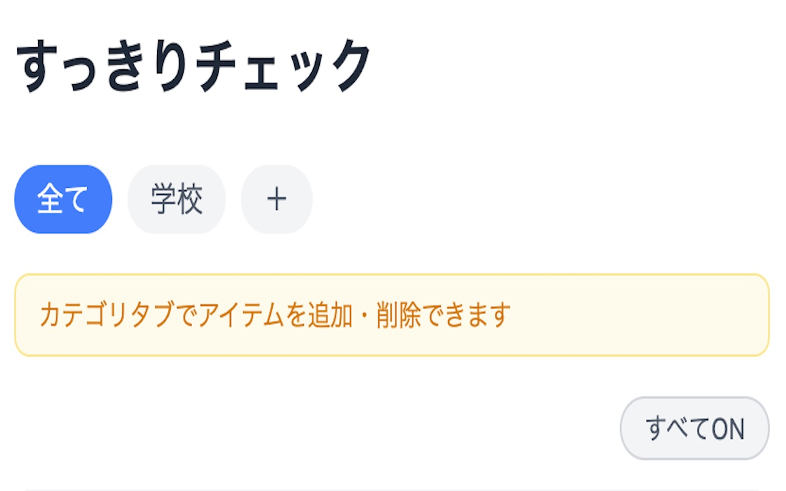
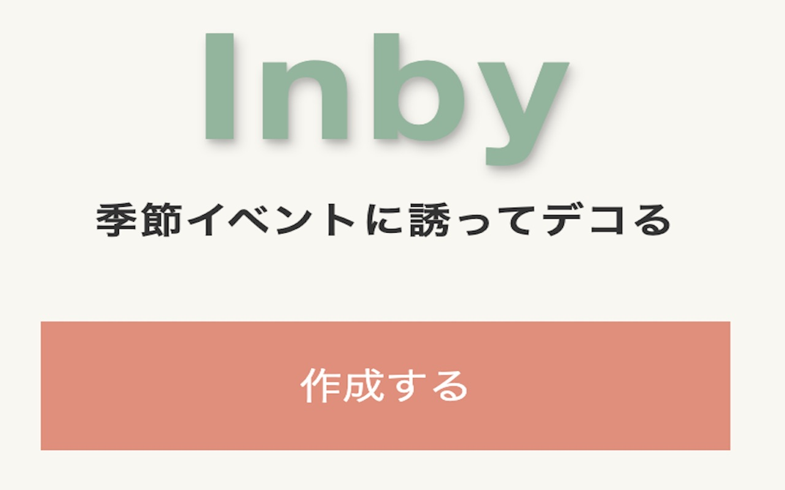
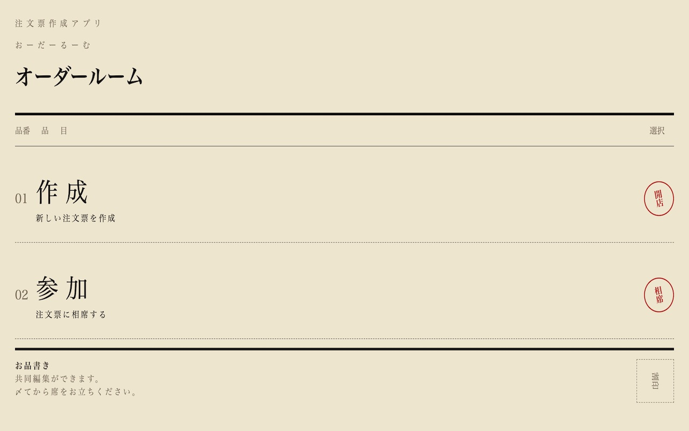
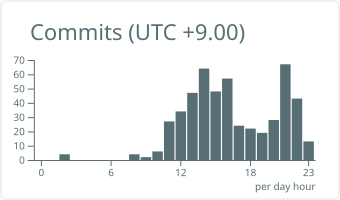

# Karuhito's Profile

🔗 **ポートフォリオサイト**: https://kazuto-enomoto.vercel.app/

---

## 自己紹介

**バックエンドエンジニア志望の専門スクール生(28卒)**

現在はJavaやTypeScriptなどの開発言語やPostgreSQLなどデータベース言語、要件定義・設計など上流工程部分の考え方、基本情報技術者の資格学習など多岐にわたる範囲の学習をしています。

---

## 🛠 Skills

### 言語

   

### フレームワーク

   

### データベース

 

### その他

  

---

## 📌 Projects

<table>
  <tr>
    <td width="280" valign="top">
      
    </td>
    <td valign="top">
      <strong>JournaLog</strong>　<a href="https://github.com/Karuhito/JournaLog_app">GitHub ↗</a>  
      Djangoを用いて日常のタスクを管理できるWebアプリケーションを開発しました。その日のGoal、Todo、スケジュール、思ったことや振り返りを記録に残すことができます。このWebアプリケーションの開発では、Djangoでの基本的なCRUD操作を学びました。  
      <code>Python</code> <code>Django</code> <code>PostgreSQL</code> <code>JavaScript</code>
    </td>
  </tr>
  <tr>
    <td width="280" valign="top">
      
    </td>
    <td valign="top">
      <strong>Fit Fight</strong>　<a href="https://github.com/Tech-Jam-KDG-2026-Winter/Team-13-HTML-CSS-JS">GitHub ↗</a>  
      チーム開発でFirebase+VanillaJSを用いて運動記録をスコア化し、フレンドと競い合うことができるWebアプリケーションを開発しました。私はスコア計算部分の実装や初期データの作成部分に携わりました。  
      <code>JavaScript</code> <code>Firebase</code> <code>チーム開発</code>
    </td>
  </tr>
  <tr>
    <td width="280" valign="top">
      
    </td>
    <td valign="top">
      <strong>GroupSync</strong>　<a href="https://github.com/Karuhito/group-schedule-adjustment-app">GitHub ↗</a>  
      [開発中] Discordのアカウント認証を利用したWebアプリケーションを開発しています。フレンドに自分の空き時間の情報を共有し合うことで一緒にゲームする予定の時間の調整をすることができます。結合テスト段階で複数のバグが見つかっているので修正対応を進めています。  
      <code>TypeScript</code> <code>React</code> <code>Python</code> <code>FastAPI</code> <code>PostgreSQL</code>
    </td>
  </tr>
  <tr>
    <td width="280" valign="top">
      
    </td>
    <td valign="top">
      <strong>すっきりチェック</strong>　<a href="https://github.com/Karuhito/belongings-check-app">GitHub ↗</a>  
      持ち物管理ができるWebアプリケーションを開発しました。ここではブラウザのLocalStorageの仕組みを学び、必ずしもデータベースを使用する必要はないということや作るものの規模に応じてデータベースを使用するかの判断を学びました。  
      <code>TypeScript</code> <code>React</code> <code>LocalStorage</code>
    </td>
  </tr>
  <tr>
    <td width="280" valign="top">
      
    </td>
    <td valign="top">
      <strong>Inby</strong>　<a href="https://github.com/KDGT2026-Summer-Techjam/Team-B-Django">GitHub ↗</a>  
      チーム開発で季節の思い出をミッション型スタンプラリーのような形式で写真の記録を残せるWebアプリケーションを開発しました。私はチームリーダーとして、GitHub上でissueを利用したタスク管理、メンバーへのタスク割り振り、Renderへのデプロイ環境の設定などを行いました。  
      <code>Python</code> <code>Django</code> <code>JavaScript</code> <code>PostgreSQL</code> <code>チーム開発</code>
    </td>
  </tr>
  <tr>
    <td width="280" valign="top">
      
    </td>
    <td valign="top">
      <strong>オーダールーム</strong>　<a href="https://github.com/sisicity4/OrderRoom">GitHub ↗</a>  
      [開発中] ホームパーティなどを開く際に必要だと思うアイテムをメンバーが提案し、ホストがアイテムを採用、却下の判断を行い、予算や実際の費用、何をいくつ購入するかをまとめられるWebアプリケーションを開発中です。3人体制でリーダー、フロントエンド、バックエンド1人ずつの体制で、私はバックエンドを担当しています。  
      <code>Java</code> <code>Spring Boot</code> <code>TypeScript</code> <code>React</code> <code>チーム開発</code>
    </td>
  </tr>
</table>

---

## 📚 学習の道のり

### 2024年
**4月〜8月**
- <a href="https://www.nnn.ed.nico/">ZEN Study(旧N予備校)</a>にてプログラミング入門アプリケーション開発講座を履修

### 2025年
**4月〜6月**
- HTML/CSSを学習

**7月〜9月**
- Pythonを学習

**10月**
- MySQLを学習
- Flaskを学習

**11月〜翌1月**
- Djangoを学習
- 個人制作で<a href="https://github.com/Karuhito/JournaLog_app">日記+ToDoアプリ</a>を制作

### 2026年
**1月〜2月**
- 校内でのチーム開発でトレーニング記録アプリを制作

**3月〜5月**
- Reactを学習
- <a href="https://github.com/Karuhito/group-schedule-adjustment-app">空き時間共有・可視化アプリ</a>を制作

**6月**
- <a href="https://github.com/Karuhito/belongings-check-app">忘れ物管理アプリ</a>を制作

**7月~現在**
- スクール内の友人2人と3人体制で<a href="https://github.com/sisicity4/OrderRoom">複数人の希望や注文をひとつに集約するアプリ</a>を開発中。私はバックエンドを担当しています。

---

## 📊 GitHub Stats

---

## 🎯 今後の目標

- GitHubにポートフォリオを充実させる
- IT資格の取得(基本情報技術等)
- IT企業のインターンに参加し、実務レベルの開発経験を積む

---

## 🐍 Contribution Snake

